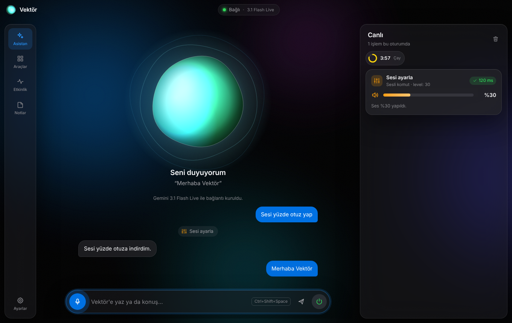
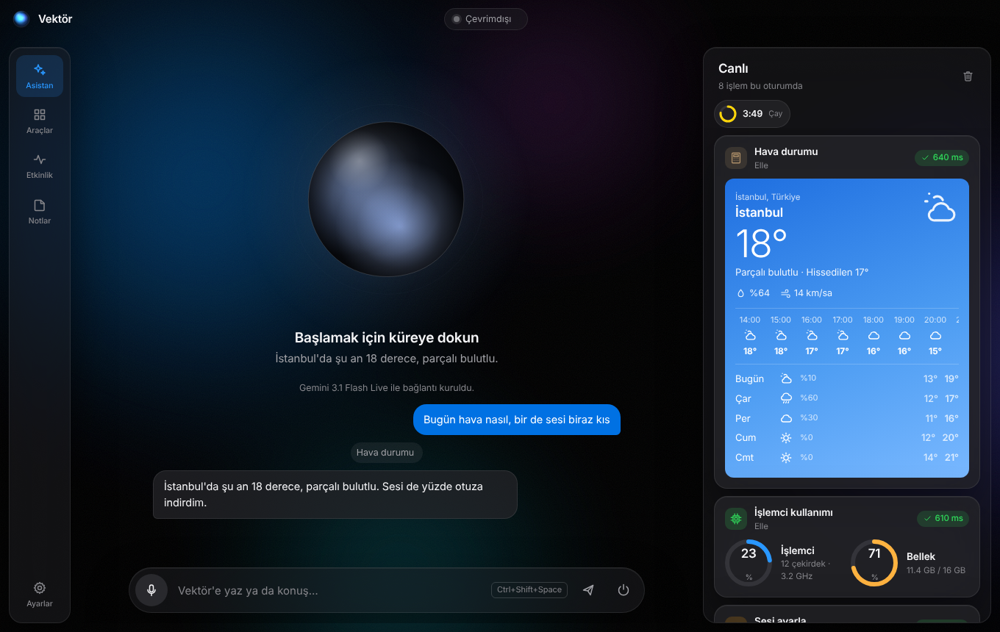
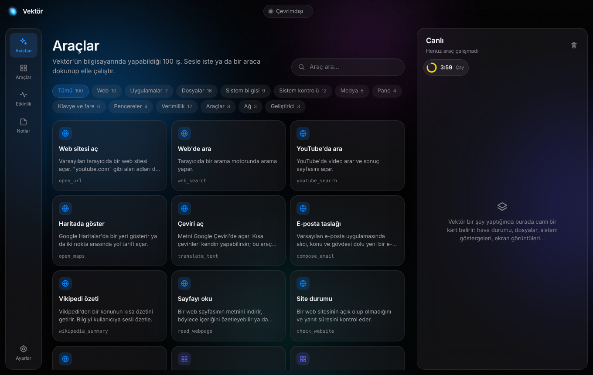
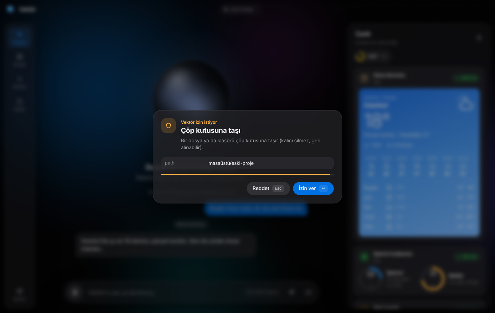
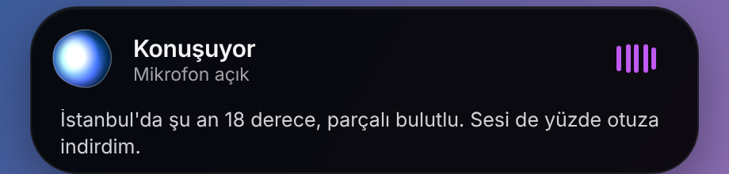

# Vektör

Vektör, bilgisayarında yaşayan sesli bir yapay zekâ asistanı. Konuşursun, **Gemini Live** seni gerçek zamanlı duyar, cevabını sesli verir ve bilgisayarını gerçekten yönetir: uygulama açar, dosya düzenler, sesi kısar, ekranına bakar, zamanlayıcı kurar, hava durumunu getirir. Yaptığı her iş, arayüzde canlı bir bileşen olarak belirir.

**İndir:** [goonedev.github.io/vektor-agent-octapus](https://goonedev.github.io/vektor-agent-octapus/)



## Neler var

- **Sesli, canlı arayüz.** Ortadaki cam küre dinlerken maviye, seni duyarken turkuaza, düşünürken mora, araç çalıştırırken turuncuya döner; kenarı ve halkaları sesin şiddetiyle nefes alır. Konuşmanın yazılı dökümü altta akar.
- **Canlı bileşenler.** Her araç çağrısı sağ panelde bir kart olarak açılır ve sonucuna göre şekil alır: hava durumu kartı, CPU/bellek halkaları, dosya listeleri, ekran görüntüsü önizlemesi, geri sayan zamanlayıcılar, klavye kısayolu tuşları, terminal çıktısı.
- **Mini ada.** Ekranın en üstünde, Dynamic Island tarzı küçük bir çubuk. Her zaman üstte durur, Vektör'ün o anki durumunu, konuşmanın altyazısını ve çalışan aracı gösterir. Üzerine gelince mikrofon ve "aç" düğmeleri çıkar; geri kalan alana tıklamalar arkadaki pencerelere geçer.
- **106 işlevsel araç.** Hepsi bilgisayarda gerçekten bir şey yapar; Windows, macOS ve Linux için ayrı ayrı uygulanmıştır. Tam liste aşağıda.
- **İşi sonuna kadar götürür.** Açılan "Yükle", "İndir", "Kaydet", "Tamam" gibi düğmelere her uygulamada kendisi basar (click_button).
- "Şarkı aç" dersen YouTube'da bulup videoyu oynatır; "Steam'den X'i indir" dersen kurulumu başlatıp "Yükle"ye basar; "şu projede şunu düzelt" dersen Claude Code'u o klasörde çalıştırıp sonucu özetler.
- **Onay her yerde.** Riskli işlerde onay ana pencerede ve mini adada çıkar; ekranın üstünden "İzin ver / Reddet" dersin.
- **Güvenlik.** Silme, kapatma, komut çalıştırma gibi riskli araçlar çalışmadan önce bir onay penceresi açılır (Enter = izin ver, Esc = reddet, 45 saniyede otomatik ret).
- **Glassmorphism + Apple paleti.** Renkler, gri tonları, ikon çizgisi ve tipografi, "Cupertino Docs" tasarım sisteminden geliyor: Apple sistem renkleri, SF Pro, 20×20 ızgarada 1.5px çizgili ikonlar. Koyu ve açık tema.

| Canlı kartlar | Araç kütüphanesi |
| --- | --- |
|  |  |

| Onay penceresi | Mini ada |
| --- | --- |
|  |  |

## Kurulum

Gereken: [Node.js](https://nodejs.org) 20 veya üstü ve bir [Gemini API anahtarı](https://aistudio.google.com/apikey) (ücretsiz alınabilir).

```bash
git clone https://github.com/goonedev/vektor-agent-octapus.git
cd vektor-agent-octapus
npm install
npm start
```

İlk açılışta **Ayarlar**'a API anahtarını yapıştır ve kaydet. İstersen anahtarı ortam değişkeniyle de verebilirsin: `GEMINI_API_KEY=... npm start`.

Kullanmak için ortadaki küreye dokun ya da her yerden **Ctrl+Shift+Space** (macOS'ta ⌘⇧Space) kısayoluna bas ve konuş. Yazarak da sorabilirsin.

### Hazır kurulum dosyası (Windows)

Node.js'e gerek yok: [indirme sitesinden](https://goonedev.github.io/vektor-agent-octapus/) ya da [Releases](https://github.com/Goonedev/vektor-agent-octapus/releases/latest) sayfasından **`Vektor-Setup-x.y.z.exe`** dosyasını indirip çalıştır. Kurulum, masaüstüne ve Başlat menüsüne kısayol ekler. Kod imzalı olmadığı için Windows "bilgisayarınızı korudu" uyarısı verebilir; **Ek bilgi › Yine de çalıştır** ile devam et.

### Uygulama içi güncelleme

Kurulum dosyasıyla kurulan Vektör, açılışta ve dört saatte bir GitHub Releases'ı denetler. Yeni sürüm varsa arka planda indirir; **Ayarlar › Güncellemeler**'de ve bildirimde **"Yeniden başlat ve güncelle"** düğmesi çıkar. Düğmeye basmasan da güncelleme bir sonraki kapanışta kurulur. Tepsi menüsünde "Güncellemeleri denetle" de var.

### Yeni sürüm yayınlamak

1. `package.json` içindeki `"version"` alanını artır (ör. `0.1.0` → `0.1.1`). Bunun için `npm version patch --no-git-tag-version` de kullanabilirsin.
2. Değişikliği `main` dalına gönder (doğrudan push ya da pull request birleştirme).

`main`'e gelen her push'ta `.github/workflows/release.yml` çalışır. O sürüm için henüz bir Release yoksa testleri koşar, Windows sunucusunda kurulum dosyasını derler ve `v0.1.1` adıyla bir GitHub Release yayınlar. Sürüm değişmediyse hiçbir şey yayınlamaz. Kurulu tüm Vektör'ler birkaç saat içinde, ya da "Güncellemeleri denetle" ile hemen, yeni sürüme geçer. İstersen `v0.1.1` gibi bir etiket göndererek de yayın başlatabilirsin.

### İndirme sitesi

`site/` klasörü, [goonedev.github.io/vektor-agent-octapus](https://goonedev.github.io/vektor-agent-octapus/) adresindeki indirme sayfasıdır. Sayfa en son sürümü GitHub'dan canlı okur; yeni sürüm çıktığında "Windows için indir" düğmesi kendiliğinden yeni kurulum dosyasını gösterir. `site/` ya da ekran görüntüleri değişip `main`'e gönderildiğinde `.github/workflows/pages.yml` siteyi yeniden yayınlar.

İlk kez açmak için bir kerelik: repo **Settings › Pages › Build and deployment › Source** alanını **GitHub Actions** yap.

Yerelde kurulum dosyası üretmek istersen (yayınlamadan):

```bash
npm run dist:win     # Windows .exe kurulum dosyası (Windows'ta çalıştır)
npm run dist:mac     # macOS .dmg (macOS'ta çalıştır)
npm run dist:linux   # Linux AppImage
```

Çıktılar `release/` klasörüne düşer.

### İzinler

- **macOS:** Klavye/fare ve pencere araçları için *Sistem Ayarları › Gizlilik ve Güvenlik › Erişilebilirlik*, ekran görüntüsü için *Ekran Kaydı* izni gerekir. Parlaklık için `brew install brightness`.
- **Linux:** Klavye/fare ve pencere araçları `xdotool` ve `wmctrl`, ses `pactl` (PulseAudio/PipeWire), medya `playerctl`, parlaklık `brightnessctl` kullanır. Eksikse araç hangi paketin gerektiğini söyler.
- **Windows:** Ek bir şey gerekmez. Ses, klavye, fare ve pencere işlemleri ilk kullanımda bir kez derlenip önbelleğe alınan küçük bir yerel yardımcıyla (`src/main/native/VektorNative.cs`) yapılır.

## Model

Varsayılan model `gemini-3.1-flash-live-preview` (yerel ses, düşük gecikme). Ayarlar'dan `gemini-2.5-flash-native-audio-latest` ya da istediğin başka bir Live modeline geçebilir, sesi (Kore, Puck, Charon...) ve asistanın kişiliğini değiştirebilirsin. Bağlantı koparsa Vektör oturumu kaldığı yerden sürdürmeyi dener.

## Mimari

```
src/
  main/                 Electron ana süreci
    main.js             pencereler, mini ada, tepsi, kısayol, onay akışı, IPC
    preload.js          arayüze açılan güvenli köprü (window.vektor)
    tools/              106 araç — kategori başına bir dosya
      index.js          kayıt, Gemini şeması, çalıştırma, onay
      util.js           platform yardımcıları (PowerShell, AppleScript, xdotool...)
    native/             Windows yerel yardımcısı (C#)
    store.js            ayarlar, notlar, görevler (JSON, atomik yazma)
    scheduler.js        zamanlayıcı, alarm, hatırlatıcı
    smoke.js            uçtan uca duman testi
    updater.js          GitHub Releases üzerinden uygulama içi güncelleme
    claudecode.js       Claude Code'u bir proje klasöründe tek seferlik çalıştırır
  renderer/             ana pencere
    live.js             Gemini Live oturumu: mikrofon akışı, ses, araç çağrıları
    audio.js            16 kHz PCM yakalama (AudioWorklet), 24 kHz kesintisiz oynatma
    orb.js              canlı küre (canvas)
    cards.js            araç sonuçlarını canlı bileşenlere çeviren kartlar
    app.js              arayüz mantığı
  mini/                 ekranın üstündeki mini ada
```

Akış: mikrofon → `AudioWorklet` (16 kHz PCM) → Gemini Live WebSocket → model bir araç çağırırsa `live.js` onu IPC ile ana sürece gönderir → `tools/index.js` gerekirse onay ister, aracı çalıştırır → sonucun **yalnızca metin kısmı** modele döner, görsel kısmı (kart, resim) arayüzde kalır. Ekran görüntüsü aracında `look=true` verilirse görüntü modele ayrıca gönderilir; böylece "ekranımda ne var?" sorusunu yanıtlayabilir.

## Geliştirme

```bash
npm test          # birim testleri (araç kaydı, hesap makinesi, eşleştirme, zamanlayıcı...)
npm run smoke     # gerçek uygulamayı açar, güvenli 45 aracı çalıştırır, pencerelerin görüntüsünü out/smoke'a kaydeder
npm run dev       # geliştirici araçlarıyla başlatır
```

Yeni bir araç eklemek için ilgili kategori dosyasına `{ name, category, title, description, params, run }` biçiminde bir nesne eklemen yeterli; Gemini şeması, araç kütüphanesi ve kartlar otomatik oluşur. Sonucun arayüzde nasıl görüneceğini `display.type` belirler (`stats`, `list`, `weather`, `image`, `timer`, `kv`, `value`...).

## 106 araç

*onaylı* işaretli araçlar çalışmadan önce izin ister.

### Web (10)

| Araç | Ne yapar |
| --- | --- |
| `open_url` | Varsayılan tarayıcıda bir web sitesi açar. "youtube.com" gibi alan adları da kabul edilir. |
| `web_search` | Tarayıcıda bir arama motorunda arama yapar. |
| `youtube_search` | YouTube'da video arar ve sonuç sayfasını açar. |
| `open_maps` | Google Haritalar'da bir yeri gösterir ya da iki nokta arasında yol tarifi açar. |
| `translate_text` | Metni Google Çeviri'de açar. Kısa çevirileri kendin yapabilirsin; bu araç kullanıcı çeviriyi ekranda görmek isterse kullanılır. |
| `compose_email` | Varsayılan e-posta uygulamasında alıcı, konu ve gövdesi dolu yeni bir e-posta taslağı açar. Göndermez. |
| `wikipedia_summary` | Vikipedi'den bir konunun kısa özetini getirir. Bilgiyi kullanıcıya sesli özetle. |
| `read_webpage` | Bir web sayfasının metnini indirir, böylece içeriğini özetleyebilir ya da soruları yanıtlayabilirsin. |
| `check_website` | Bir web sitesinin açık olup olmadığını ve yanıt süresini kontrol eder. |
| `download_file` | Bir adresteki dosyayı İndirilenler klasörüne kaydeder. |

### Uygulamalar (9)

| Araç | Ne yapar |
| --- | --- |
| `open_app` | Bilgisayardaki bir uygulamayı adıyla başlatır (Chrome, Spotify, Word, Hesap Makinesi, Discord...). |
| `close_app` | Çalışan bir uygulamayı nazikçe kapatır (kaydedilmemiş iş varsa uygulama sorar). |
| `list_running_apps` | Şu an çalışan uygulamaları en çok bellek kullananlardan başlayarak listeler. |
| `kill_process` · *onaylı* | Yanıt vermeyen bir işlemi PID ya da adıyla zorla sonlandırır. Kaydedilmemiş veriler kaybolabilir. |
| `open_system_settings` | İşletim sisteminin ayarlar uygulamasını belirli bir bölümde açar. |
| `open_terminal` | Belirtilen klasörde bir terminal penceresi açar. |
| `open_task_manager` | Görev Yöneticisi / Etkinlik Monitörü'nü açar. |
| `steam_install` · *onaylı* | Bir oyunu Steam mağazasında bulur, Steam'de kurulumu başlatır ve Steam'in Yükle penceresini onaylayarak indirmeyi başlatır (Windows). Ücretli oyunlarda satın alma gerekir. |
| `steam_launch` | Steam'de kurulu bir oyunu adıyla başlatır. |

### Dosyalar (16)

| Araç | Ne yapar |
| --- | --- |
| `list_directory` | Bir klasörün içeriğini listeler. "masaüstü", "indirilenler", "belgeler" gibi takma adları anlar. |
| `read_text_file` | Bir metin dosyasının içeriğini okur (txt, md, kod, csv, json...). |
| `write_text_file` · *onaylı* | Yeni bir metin dosyası oluşturur. Var olan bir dosyanın üstüne yazmak kullanıcı onayı ister. |
| `append_text_file` | Bir metin dosyasının sonuna satır ekler; dosya yoksa oluşturur. |
| `create_folder` | Yeni bir klasör oluşturur (ara klasörlerle birlikte). |
| `move_to_trash` · *onaylı* | Bir dosya ya da klasörü çöp kutusuna taşır (kalıcı silmez, geri alınabilir). |
| `move_path` | Bir dosya ya da klasörü başka yere taşır veya yeniden adlandırır. Hedef bir klasörse içine taşınır. |
| `copy_path` | Bir dosya ya da klasörü başka bir yere kopyalar. |
| `search_files` | Bir klasör ve alt klasörlerinde adına göre dosya arar. "*.pdf" gibi kalıplar ya da ad parçası kabul eder. |
| `recent_files` | Bir klasördeki (varsayılan İndirilenler) en son değişen dosyaları gösterir. |
| `file_info` | Bir dosya ya da klasörün boyutunu, tarihlerini ve türünü gösterir. Klasörler için toplam boyutu hesaplar. |
| `open_path` | Bir dosyayı varsayılan uygulamasıyla ya da bir klasörü dosya yöneticisinde açar. |
| `reveal_in_folder` | Dosyayı bulunduğu klasörde seçili olarak gösterir. |
| `compress_zip` | Bir dosya ya da klasörü ZIP arşivi olarak sıkıştırır. |
| `extract_zip` | Bir ZIP arşivini bir klasöre çıkarır. |
| `organize_folder` · *onaylı* | Bir klasördeki dosyaları türlerine göre alt klasörlere (Resimler, Belgeler, Videolar, Arşivler...) taşır. İndirilenler/Masaüstü temizliği için idealdir. |

### Sistem bilgisi (9)

| Araç | Ne yapar |
| --- | --- |
| `system_overview` | İşletim sistemi, işlemci, bellek, açık kalma süresi ve kullanıcı bilgisini gösterir. |
| `cpu_usage` | Anlık işlemci kullanımını ve yükü ölçer. |
| `memory_usage` | RAM kullanımını gösterir. |
| `battery_status` | Pil yüzdesini, şarj durumunu ve kalan süreyi gösterir. |
| `disk_space` | Disklerin dolu ve boş alanını gösterir. |
| `network_info` | Yerel IP adreslerini ve ağ bağdaştırıcılarını listeler. |
| `public_ip` | İnternete çıkan genel IP adresini ve yaklaşık konumu (şehir, ülke, servis sağlayıcı) gösterir. |
| `list_displays` | Bağlı monitörleri, çözünürlüklerini ve ölçeklemeyi listeler. |
| `current_datetime` | Şu anki tarih, saat, gün ve saat dilimini verir. |

### Sistem kontrolü (12)

| Araç | Ne yapar |
| --- | --- |
| `get_volume` | Sistem ses düzeyini ve sessiz durumunu okur. |
| `set_volume` | Sistem ses düzeyini ayarlar. Ya mutlak düzey (0–100) ya da göreli değişim (ör. +10, -20) ver. |
| `set_mute` | Sistem sesini kapatır ya da açar. |
| `set_brightness` | Ekran parlaklığını 0–100 arası ayarlar (dizüstü ekranlarda çalışır). |
| `lock_screen` | Bilgisayarı kilitler. |
| `sleep_computer` · *onaylı* | Bilgisayarı uyku moduna alır; isteğe bağlı olarak birkaç dakika sonra. |
| `shutdown_computer` · *onaylı* | Bilgisayarı kapatır; isteğe bağlı olarak belirli dakika sonra (zamanlayıcı cancel_shutdown ile iptal edilebilir). |
| `restart_computer` · *onaylı* | Bilgisayarı yeniden başlatır; isteğe bağlı olarak belirli dakika sonra. |
| `cancel_shutdown` | Zamanlanmış kapatma, yeniden başlatma ya da uykuyu iptal eder. |
| `empty_trash` · *onaylı* | Geri dönüşüm kutusunu / çöp kutusunu kalıcı olarak boşaltır. |
| `set_dark_mode` | İşletim sisteminin karanlık / aydınlık temasını değiştirir. |
| `set_wallpaper` | Masaüstü duvar kağıdını bir resim dosyasıyla değiştirir. |

### Medya (7)

| Araç | Ne yapar |
| --- | --- |
| `media_play_pause` | Çalan müziği ya da videoyu duraklatır veya devam ettirir (Spotify, YouTube, Apple Music...). |
| `media_next` | Sonraki şarkıya / videoya geçer. |
| `media_previous` | Önceki şarkıya / videoya döner. |
| `take_screenshot` | Ekran görüntüsü alır ve Resimler/Vektör klasörüne kaydeder. Kullanıcı "ekranımda ne var", "şuna bak" derse look=true ver; görüntü sana gönderilir ve yorumlayabilirsin. |
| `screenshot_to_clipboard` | Ekran görüntüsü alıp doğrudan panoya kopyalar, yapıştırmaya hazır. |
| `open_camera` | Kamera uygulamasını açar. |
| `play_youtube` | Bir şarkıyı ya da videoyu YouTube'da bulur ve doğrudan oynatır (arama sayfasında bırakmaz). "Şarkı aç", "şu videoyu aç", "biraz müzik çal" gibi isteklerde bunu kullan. |

### Pano (4)

| Araç | Ne yapar |
| --- | --- |
| `clipboard_read` | Panodaki metni okur. Kullanıcı "kopyaladığım şeyi özetle/çevir" derse kullan. |
| `clipboard_write` | Verilen metni panoya kopyalar; kullanıcı istediği yere yapıştırabilir. |
| `clipboard_clear` | Panoyu ve Vektör'ün pano geçmişini temizler (ör. bir şifre kopyaladıktan sonra). |
| `clipboard_history` | Vektör açıkken panoya kopyalanan son metinleri listeler. |

### Klavye ve fare (8)

| Araç | Ne yapar |
| --- | --- |
| `type_text` | Odaktaki pencereye klavyeden yazıyormuş gibi metin yazar (Türkçe karakterler dahil). |
| `press_keys` | Bir tuş ya da kısayol gönderir: "ctrl+c", "alt+tab", "win+d", "cmd+space", "enter", "f5", "ctrl+shift+esc". |
| `mouse_move` | Fare imlecini ekran koordinatına (piksel) taşır. |
| `mouse_click` | Fareyle tıklar. Koordinat verilirse önce oraya gider. |
| `mouse_scroll` | Fare tekerleğiyle kaydırır. Pozitif = yukarı, negatif = aşağı. |
| `show_desktop` | Tüm pencereleri küçültüp masaüstünü gösterir. |
| `click_button` | Öndeki uygulamada üstünde yazan metne göre bir düğmeye, bağlantıya ya da menü öğesine basar: "Yükle", "İndir", "Kaydet", "Tamam", "Evet", "İleri" gibi. Bir işlemi bitirmek için açılan pencerelerdeki düğmeyi tamamlamak için bunu kullan; ekranı tahmin edip koordinat tıklamana gerek kalmaz. |
| `list_buttons` | Öndeki penceredeki basılabilir düğme, bağlantı ve menü öğelerinin adlarını listeler. "Ekranda hangi düğmeler var?" ya da bir işlemi bitirmeden önce doğru düğmenin adını öğrenmek için kullan. |

### Pencereler (4)

| Araç | Ne yapar |
| --- | --- |
| `list_windows` | Ekrandaki açık pencereleri uygulama adlarıyla listeler. |
| `focus_window` | Başlığı ya da uygulama adı eşleşen pencereyi öne getirir. |
| `maximize_window` | Etkin pencereyi ekranı kaplayacak şekilde büyütür. |
| `minimize_window` | Etkin pencereyi simge durumuna küçültür. |

### Verimlilik (12)

| Araç | Ne yapar |
| --- | --- |
| `set_timer` | Geri sayım zamanlayıcısı kurar; süre dolunca bildirim ve ses verir, sen de kullanıcıya haber verirsin. |
| `set_alarm` | Belirli bir saate alarm kurar (ör. "07:30"). Saat geçmişse yarına kurulur. |
| `set_reminder` | Bir şeyi hatırlatmak için hatırlatıcı kurar. Ya dakika sonra ya da belirli zamanda. |
| `list_timers` | Aktif zamanlayıcıları, alarmları ve hatırlatıcıları listeler. |
| `cancel_timer` | Bir zamanlayıcı, alarm ya da hatırlatıcıyı adıyla ya da kimliğiyle iptal eder. "hepsi" hepsini iptal eder. |
| `show_notification` | Masaüstünde bir sistem bildirimi gösterir. |
| `add_note` | Vektör not defterine bir not kaydeder. |
| `list_notes` | Kayıtlı notları listeler; isteğe bağlı olarak içinde arama yapar. |
| `delete_note` | Bir notu kimliğiyle ya da başlığındaki bir kelimeyle siler. |
| `add_todo` | Yapılacaklar listesine bir görev ekler. |
| `list_todos` | Yapılacaklar listesini gösterir. |
| `complete_todo` | Bir görevi tamamlandı olarak işaretler. |

### Araçlar (8)

| Araç | Ne yapar |
| --- | --- |
| `calculate` | Matematik ifadesini kesin olarak hesaplar: + - * / ^ %, parantez, sqrt, sin (derece), log, ln, fact, pi. Yüzde: "1500 * 18%" ya da "200 + 10%". Sayısal sonuçları her zaman bununla hesapla, tahmin etme. |
| `convert_units` | Uzunluk, ağırlık, hacim, sıcaklık (c/f/k), hız, veri boyutu, süre, alan, enerji ve basınç birimleri arasında çevirir. Birimleri kısaltmayla ver: km, mi, kg, lb, l, gal, c, f, mb, gb, km/h, mph, m2, kwh... |
| `convert_currency` | Güncel kurlarla para birimi çevirir (USD, EUR, TRY, GBP, JPY...). |
| `get_weather` | Bir şehrin anlık hava durumunu ve 5 günlük tahminini getirir. Şehir verilmezse kullanıcının konumu kullanılır. |
| `get_news` | Google Haberler'den güncel manşetleri ya da bir konudaki haberleri getirir. |
| `world_clock` | Bir ya da birden fazla şehirde şu an saatin kaç olduğunu gösterir. |
| `generate_password` | Güçlü, rastgele bir şifre üretir ve panoya kopyalar. Şifreyi sesli okuma; sadece panoda olduğunu söyle. |
| `random_pick` | Yazı tura atar, zar atar, aralıkta rastgele sayı üretir ya da bir listeden seçim yapar. |

### Ağ (3)

| Araç | Ne yapar |
| --- | --- |
| `ping_host` | Bir sunucuya ping atarak gecikmeyi ve paket kaybını ölçer. İnternet bağlantısını test etmek için 8.8.8.8 kullan. |
| `dns_lookup` | Bir alan adının IP adreslerini ve kayıtlarını sorgular. |
| `check_port` | Bir sunucuda TCP portunun açık olup olmadığını kontrol eder (ör. localhost 3000). |

### Geliştirici (4)

| Araç | Ne yapar |
| --- | --- |
| `run_command` · *onaylı* | Terminal komutu çalıştırır ve çıktısını döndürür (Windows'ta PowerShell, diğerlerinde sh). Başka araç işi görmüyorsa kullan; her çalıştırma kullanıcı onayı ister. |
| `git_status` | Bir proje klasörünün git dalını, değişen dosyalarını ve son commitlerini gösterir. |
| `open_in_vscode` | Bir dosya ya da klasörü Visual Studio Code'da açar. |
| `ask_claude_code` · *onaylı* | Kullanıcı bir projede kod işi istediğinde Claude Code'u o proje klasöründe bir kez çalıştırır (kod yazma, analiz, hata düzeltme). Claude yalnızca o klasördeki dosyaları düzenler. "Devam et" denirse continue=true ile aynı oturumdan sürdür. Cevabı kullanıcıya kısaca özetle. |

## Lisans

Apache 2.0 — ayrıntılar için [LICENSE](LICENSE).
